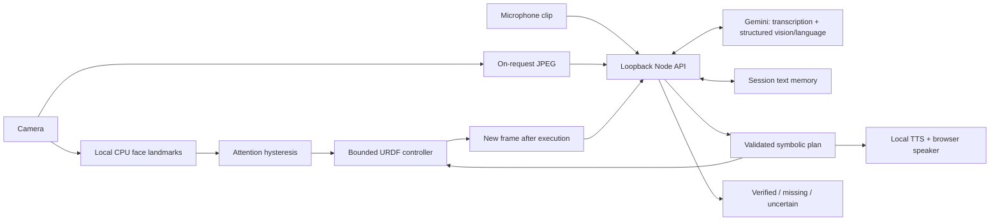

# Luma — technical note

## Architecture and data flow

The browser owns device capture, attention, rendering, body execution, and playback. Node owns cloud credentials, schema validation, session memory, and turn ordering. Gemini chooses intent, observations, and symbolic actions; it never executes code or directly controls joints. Attention stays local. Requests send a JPEG (up to 480 px), utterance, and bounded text context; recorded speech is uploaded for transcription. No continuous video is uploaded. Voice, chime, and melody are local.

## Protocol, control, and design choices

HTTP JSON protocol `luma.v1` uses a session UUID and server-issued turn UUID. A turn includes `{text, frame: {image, captured_at}}`. The validated response contains `reply`, `intent`, `objects`, `actions`, `goal`, and `evidence`. At most four actions use `{type, x, y, brightness, color, duration_ms}`; types are orient, nod, light, celebrate, or rest. Coordinates/brightness are normalized; requested durations are 300–3000 ms. Motion constraints can lengthen execution.

A goal stays pending until `/api/verify` receives the matching turn and a fresh frame captured after action completion. The browser waits for a new video frame; the server checks timestamps, rejects stale/replayed frames, and returns confirmed, not_confirmed, or uncertain. These checks enforce cooperative client ordering, not cryptographic proof of camera provenance. Cancellation aborts the active provider call and invalidates late results without blocking a replacement turn. Malformed plans execute nothing; failed verification never counts as success.

Common people labels are excluded from object memory; goal aiming requires a nearby, confident observation in the current plan. This consistency check cannot prove that the model saw correctly. Memory retains up to 20 object labels, descriptions, confidence, first/last observation timestamps, and sighting counts. Missing objects remain recallable; low-confidence observations cannot overwrite reliable memory. Matching by label is deliberately simple and can merge similar objects. Conversation history is bounded. Reload/reset creates a new session; there is no persistent personal profile.

Three.js and URDFLoader render the supplied body. The controller reads URDF soft limits and velocity limits, clamps destinations, and uses cubic trajectories sized for ≤75% of specified velocity and nominal acceleration ≤3 rad/s². Rendering time steps are capped. Emergency Stop freezes the pose immediately; its discontinuity is acceptable for a visualization, not a physical robot. No dynamics, torque, contact, collision, or stability simulation is claimed. Image coordinates map heuristically to yaw/pitch; there is no calibrated camera extrinsic transform. The fixed laptop camera and real scene are unaffected by virtual movement/light.

CPU MediaPipe landmarks run in a worker at roughly 6 Hz. A frontal-face heuristic engages after 700 ms and disengages after 1800 ms; an 18-second greeting cooldown reduces repetition. It detects approximate head orientation, not eye gaze or intention. Speaking/acting completes before idle disengagement; Stop interrupts immediately.

## Deployment and evidence

Node 24, Chrome/Chromium, and `espeak-ng` target Ubuntu 24.04 with four cores/8 GB and integrated graphics. Local CPU perception plus remote vision/language avoids large local models and CUDA. Dependencies are pinned; the face model is downloaded by setup. The loopback server keeps credentials outside browser code. See README for installation and the continuous demo.

Development measurements: Apple M4, 24 GB, macOS, Node 25.8. These are small observations, not an Ubuntu benchmark:

| Check | Observed result |
|---|---|
| Control/protocol/API regression suite | 20 tests pass on Node 24 and 25; Gemini mocked |
| Live local face inference | approximately 12–24 ms/frame in the UI |
| Controlled image goal planning | 1.741 s |
| Fresh blank-image verification | 1.002 s; correctly not confirmed |
| Recall after object removal | 1.087 s; remembered white color |
| Server resources | 67 MB RSS; 0.148% of one CPU core over a 30 s sample |
| Browser rendering | 60 FPS in the observed local scene |
| Two live pen goals | Plan 2.36–2.83 s; verification 1.59–2.22 s |
| Live scene memory | Black pen recognized twice; replies took 13–20 s |
| Engagement reliability | 3/3 face/away cycles; user-reported, one person |

Controlled tests used the supplied lamp illustration followed by a blank image. Live transcription took 1.2–3.7 s in sampled turns. Vision also hit 30 s timeouts; successful fixture requests do not establish live reliability. The CPU sample included one transcription and one voice-generation request; it excludes the browser and is not a peak-load test. The user confirmed the live goal flow; the UI showed correct pen-present and pen-absent checks, with the latter taking 13.8 s including speech/motion. The user also confirmed successful microphone-based remember and later color recall. The engagement sample is only three cycles, not population-level accuracy. Browser memory, a recorded continuous demo, and clean Ubuntu deployment remain unmeasured. Session export provides raw diagnostic timings; record face/away ground truth separately.

Limits include cloud latency/quotas, model hallucination, lighting/occlusion sensitivity, basic object association, no wake word, and no physical manipulation. AI-assisted development was used; model selection, bounded control, explicit verification, and honest failure reporting are deliberate engineering choices.
